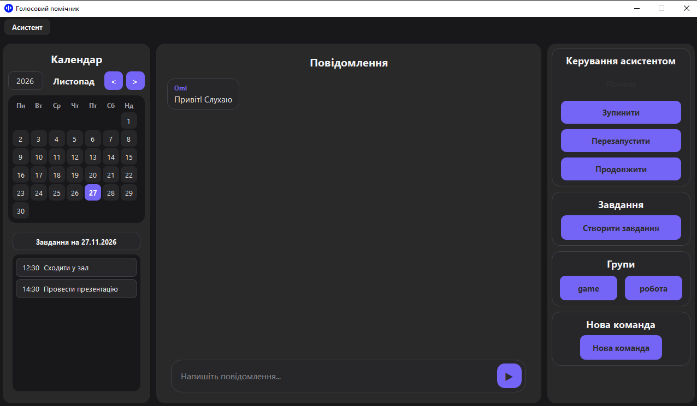
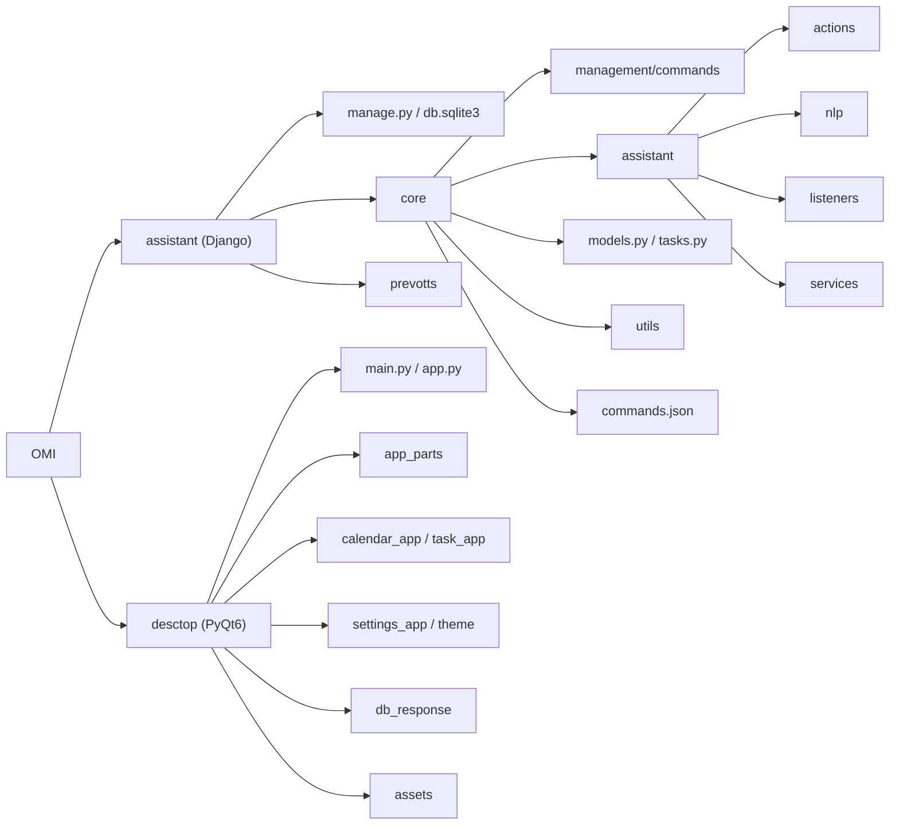

<div align="center">

<br>

<br>
<br>

<h1>Omi — голосовий помічник</h1>

<div align="center">

<a href="#install">
  <span style="font-size: 18px;"><b>Встановлення та запуск »</b></span>
</a>

<details>
  <summary style="font-style: italic; font-size: 14px;">English translation</summary>
  <a href="#install-eng">
    <span style="font-size: 18px;"><b>Installation and launch »</b></span>
  </a>
</details>
<br>

</div>

<h3>Голосовий помічник для Windows з українським розпізнаванням мови та вікном на PyQt6.</h3>

<p style="font-size: 16px;">
    Omi відкриває програми, знаходить файли, читає розклад і відповідає на запитання. Керувати можна голосом або текстом.
</p>

<p style="font-size: 14px;">
    Python 3.12+, Django 6.1, PyQt6.
</p>

<details>
  <summary style="font-style: italic; font-size: 14px;">English translation</summary>
  <h3>A voice assistant for Windows with Ukrainian speech recognition and a PyQt6 window.</h3>

  <p style="font-size: 16px;">
      Omi opens apps, finds files, reads your schedule and answers questions. You can control it by voice or by text.
  </p>

  <p style="font-size: 14px;">
      Python 3.12+, Django 6.1, PyQt6.
  </p>
</details>
<br>

</div>

<div align="center">
    
</div>

<h1 id="top">Навігація</h1>

<ul style="font-size: 18px; line-height: 1.9;">
  <li>📁 <a href="#project-structure">Структура проєкту</a></li>
  <li>🧠 <a href="#all-modules">Технології проєкту</a></li>
  <li>🖥️ <a href="#install">Встановлення та запуск</a>
    <ul style="font-size: 16px; line-height: 1.6;">
      <li><a href="#ready-exe">Готовий .exe файл</a></li>
      <li><a href="#run-source">Запуск із коду</a></li>
      <li><a href="#build-exe">Збірка .exe самостійно</a></li>
    </ul>
  </li>
  <li>⚙️ <a href="#how-it-works">Як працює помічник</a>
    <ul style="font-size: 16px; line-height: 1.6;">
      <li><a href="#process">Вікно і процес помічника</a></li>
      <li><a href="#main-loop">Головний цикл</a></li>
      <li><a href="#mic-control">Керування мікрофоном</a></li>
      <li><a href="#listeners">Розпізнавання мови</a></li>
      <li><a href="#whisper">Whisper і тиша</a></li>
      <li><a href="#tts">Озвучка відповідей</a></li>
      <li><a href="#echo">Omi не слухає себе</a></li>
    </ul>
  </li>
  <li>🧩 <a href="#commands">Команди</a>
    <ul style="font-size: 16px; line-height: 1.6;">
      <li><a href="#actions">Система дій</a></li>
      <li><a href="#matcher">Пошук команди</a></li>
      <li><a href="#phrases">Фрази в базі даних</a></li>
      <li><a href="#dialog">Діалоги й підтвердження</a></li>
      <li><a href="#answers">Відповіді так, ні, скасуй</a></li>
      <li><a href="#numbers">Числа словами</a></li>
    </ul>
  </li>
  <li>🎙️ <a href="#features">Можливості</a>
    <ul style="font-size: 16px; line-height: 1.6;">
      <li><a href="#apps">Програми, групи, сайти</a></li>
      <li><a href="#first-scan">Пошук програм при першому запуску</a></li>
      <li><a href="#groups">Групи програм</a></li>
      <li><a href="#paths">Файли та папки</a></li>
      <li><a href="#find-files">Пошук файлів</a></li>
      <li><a href="#move">Перенесення файлів</a></li>
      <li><a href="#schedule">Розклад голосом</a></li>
      <li><a href="#ask-ai">Запитання до ШІ</a></li>
      <li><a href="#gemini">Контекст часу для ШІ</a></li>
      <li><a href="#system">Керування системою</a></li>
    </ul>
  </li>
  <li>🖼️ <a href="#window">Вікно програми</a>
    <ul style="font-size: 16px; line-height: 1.6;">
      <li><a href="#chat">Чат і панелі</a></li>
      <li><a href="#calendar">Календар</a></li>
      <li><a href="#task-form">Форма завдання</a></li>
      <li><a href="#settings">Налаштування і теми</a></li>
    </ul>
  </li>
  <li>🗄️ <a href="#database">База даних</a></li>
  <li>🎯 <a href="#result">Висновок</a></li>
</ul>

<h1 id="top-eng">Navigation</h1>
<details>
<summary style="font-size: 18px; font-weight: bold;">English translation</summary>

<ul style="font-size: 18px; line-height: 1.9;">
  <li>📁 <a href="#project-structure-eng">Project Structure</a></li>
  <li>🧠 <a href="#all-modules-eng">Project Technologies</a></li>
  <li>🖥️ <a href="#install-eng">Installation and Launch</a>
    <ul style="font-size: 16px; line-height: 1.6;">
      <li><a href="#ready-exe-eng">Ready-made .exe file</a></li>
      <li><a href="#run-source-eng">Running from source</a></li>
      <li><a href="#build-exe-eng">Building the .exe yourself</a></li>
    </ul>
  </li>
  <li>⚙️ <a href="#how-it-works-eng">How the Assistant Works</a>
    <ul style="font-size: 16px; line-height: 1.6;">
      <li><a href="#process-eng">Window and assistant process</a></li>
      <li><a href="#main-loop-eng">Main loop</a></li>
      <li><a href="#mic-control-eng">Microphone control</a></li>
      <li><a href="#listeners-eng">Speech recognition</a></li>
      <li><a href="#whisper-eng">Whisper and silence</a></li>
      <li><a href="#tts-eng">Voice answers</a></li>
      <li><a href="#echo-eng">Omi does not hear herself</a></li>
    </ul>
  </li>
  <li>🧩 <a href="#commands-eng">Commands</a>
    <ul style="font-size: 16px; line-height: 1.6;">
      <li><a href="#actions-eng">Action system</a></li>
      <li><a href="#matcher-eng">Finding a command</a></li>
      <li><a href="#phrases-eng">Phrases in the database</a></li>
      <li><a href="#dialog-eng">Dialogs and confirmation</a></li>
      <li><a href="#answers-eng">Answers yes, no, cancel</a></li>
      <li><a href="#numbers-eng">Numbers in words</a></li>
    </ul>
  </li>
  <li>🎙️ <a href="#features-eng">Features</a>
    <ul style="font-size: 16px; line-height: 1.6;">
      <li><a href="#apps-eng">Apps, groups, sites</a></li>
      <li><a href="#first-scan-eng">App scan on first launch</a></li>
      <li><a href="#groups-eng">App groups</a></li>
      <li><a href="#paths-eng">Files and folders</a></li>
      <li><a href="#find-files-eng">File search</a></li>
      <li><a href="#move-eng">Moving files</a></li>
      <li><a href="#schedule-eng">Schedule by voice</a></li>
      <li><a href="#ask-ai-eng">Questions to AI</a></li>
      <li><a href="#gemini-eng">Time context for AI</a></li>
      <li><a href="#system-eng">System control</a></li>
    </ul>
  </li>
  <li>🖼️ <a href="#window-eng">Application Window</a>
    <ul style="font-size: 16px; line-height: 1.6;">
      <li><a href="#chat-eng">Chat and panels</a></li>
      <li><a href="#calendar-eng">Calendar</a></li>
      <li><a href="#task-form-eng">Task form</a></li>
      <li><a href="#settings-eng">Settings and themes</a></li>
    </ul>
  </li>
  <li>🗄️ <a href="#database-eng">Database</a></li>
  <li>🎯 <a href="#result-eng">Conclusion</a></li>
</ul>

</details>
<br>

<div align="right">
    <a href="#top">⬆ До початку сторінки</a>
</div>

<hr>

<a id="project-structure"></a>
<a id="project-structure-eng"></a>
<details>
<summary style="font-size: 2em; font-weight: bold;">Структура проєкту / Project Structure</summary>



</details>
<br>

<div align="right">
    <a href="#top">⬆ До початку сторінки</a>
</div>

<hr>

<h1 id="all-modules">Технології проєкту</h1>

<p style="text-align: justify; line-height: 1.8;">
  <a href="https://www.python.org/" style="font-size: 20px;">Python 3.12+</a>
  <span style="font-size: 16px;"> - мова програмування проєкту.</span>
  <br>
  <a href="https://www.djangoproject.com/" style="font-size: 20px;">Django 6.1</a>
  <span style="font-size: 16px;"> - моделі, міграції та SQLite для даних помічника.</span>
  <br>
  <a href="https://www.riverbankcomputing.com/software/pyqt/" style="font-size: 20px;">PyQt6</a>
  <span style="font-size: 16px;"> - графічне вікно з чатом, календарем і формами.</span>
  <br>
  <a href="https://github.com/rapidfuzz/RapidFuzz" style="font-size: 20px;">RapidFuzz</a>
  <span style="font-size: 16px;"> - нечіткий пошук команд, програм і файлів.</span>
  <br>
  <a href="https://github.com/SYSTRAN/faster-whisper" style="font-size: 20px;">faster-whisper</a>
  <span style="font-size: 16px;"> - розпізнавання мови на відеокарті (CUDA).</span>
  <br>
  <a href="https://github.com/Uberi/speech_recognition" style="font-size: 20px;">SpeechRecognition</a>
  <span style="font-size: 16px;"> - запасне розпізнавання мови через Google.</span>
  <br>
  <a href="https://github.com/rany2/edge-tts" style="font-size: 20px;">edge-tts + pygame</a>
  <span style="font-size: 16px;"> - озвучка відповідей голосом uk-UA-PolinaNeural.</span>
  <br>
  <a href="https://ai.google.dev/" style="font-size: 20px;">Google Gemini (google-genai)</a>
  <span style="font-size: 16px;"> - відповіді на запитання користувача.</span>
  <br>
  <a href="https://github.com/arsenetar/send2trash" style="font-size: 20px;">send2trash</a>
  <span style="font-size: 16px;"> - видалення файлів у кошик, а не назавжди.</span>
</p>

<h1 id="all-modules-eng">Project Technologies</h1>

<details>
  <summary style="font-style: italic; font-size: 14px;">English translation</summary>
  <br>
<p style="text-align: justify; line-height: 1.8;">
  <a href="https://www.python.org/" style="font-size: 20px;">Python 3.12+</a>
  <span style="font-size: 16px;"> - the programming language of the project.</span>
  <br>
  <a href="https://www.djangoproject.com/" style="font-size: 20px;">Django 6.1</a>
  <span style="font-size: 16px;"> - models, migrations and SQLite for the assistant data.</span>
  <br>
  <a href="https://www.riverbankcomputing.com/software/pyqt/" style="font-size: 20px;">PyQt6</a>
  <span style="font-size: 16px;"> - the graphical window with chat, calendar and forms.</span>
  <br>
  <a href="https://github.com/rapidfuzz/RapidFuzz" style="font-size: 20px;">RapidFuzz</a>
  <span style="font-size: 16px;"> - fuzzy search of commands, apps and files.</span>
  <br>
  <a href="https://github.com/SYSTRAN/faster-whisper" style="font-size: 20px;">faster-whisper</a>
  <span style="font-size: 16px;"> - speech recognition on a video card (CUDA).</span>
  <br>
  <a href="https://github.com/Uberi/speech_recognition" style="font-size: 20px;">SpeechRecognition</a>
  <span style="font-size: 16px;"> - fallback speech recognition via Google.</span>
  <br>
  <a href="https://github.com/rany2/edge-tts" style="font-size: 20px;">edge-tts + pygame</a>
  <span style="font-size: 16px;"> - voice answers with the uk-UA-PolinaNeural voice.</span>
  <br>
  <a href="https://ai.google.dev/" style="font-size: 20px;">Google Gemini (google-genai)</a>
  <span style="font-size: 16px;"> - answers to the user's questions.</span>
  <br>
  <a href="https://github.com/arsenetar/send2trash" style="font-size: 20px;">send2trash</a>
  <span style="font-size: 16px;"> - moving files to the recycle bin instead of deleting them.</span>
</p>
</details>
<br>

<div align="right">
    <a href="#top">⬆ До початку сторінки</a>
</div>

<hr>

<h1 id="install">Встановлення та запуск</h1>
<p style="text-align: justify; font-size: 18px; line-height: 1.7;">
    Omi можна запустити з готового файлу або з коду. Програма працює на Windows 10/11 і потребує мікрофон та інтернет.
</p>

<h1 id="install-eng">Installation and Launch</h1>

<details>
  <summary style="font-style: italic; font-size: 14px;">English translation</summary>
  <br>
  <p style="text-align: justify; font-size: 18px; line-height: 1.7;">
      Omi can be started from a ready-made file or from source. The app works on Windows 10/11 and needs a microphone and internet.
  </p>
</details>
<br>

<hr>

<h3 style="font-size: 20px;" id="ready-exe">
    Готовий .exe файл
</h3>
<p style="text-align: justify; font-size: 16px; line-height: 1.7;">
    Готовий файл лежить у папці <b>releases</b> репозиторію: <b>releases/Omi.exe</b>. Python встановлювати не потрібно. Щоб працювали відповіді ШІ, створіть у корені проєкту файл <b>.env</b> з рядком <b>GEMINI_API_KEY=ваш_ключ</b>.
</p>

<h3 style="font-size: 20px;" id="ready-exe-eng">
    Ready-made .exe file
</h3>
<details>
  <summary style="font-style: italic; font-size: 14px;">English translation</summary>
  <br>
  <p style="text-align: justify; font-size: 16px; line-height: 1.7;">
      The ready-made file is in the <b>releases</b> folder of the repository: <b>releases/Omi.exe</b>. You do not need to install Python. For AI answers, create a <b>.env</b> file in the project root with the line <b>GEMINI_API_KEY=your_key</b>.
  </p>
</details>
<hr>

<h3 style="font-size: 20px;" id="run-source">
    Запуск із коду
</h3>
<p style="text-align: justify; font-size: 16px; line-height: 1.7;">
    Потрібен Python 3.12 або новіший. Спочатку встановіть бібліотеки, потім підготуйте базу й запустіть вікно. Розпізнавання через faster-whisper працює лише з відеокартою NVIDIA, інакше помічник сам обере Google.
</p>

<h3 style="font-size: 20px;" id="run-source-eng">
    Running from source
</h3>
<details>
  <summary style="font-style: italic; font-size: 14px;">English translation</summary>
  <br>
  <p style="text-align: justify; font-size: 16px; line-height: 1.7;">
      Python 3.12 or newer is required. First install the libraries, then prepare the database and start the window. Recognition with faster-whisper works only with an NVIDIA video card, otherwise the assistant picks Google by itself.
  </p>
</details>

```bash
pip install django PyQt6 rapidfuzz SpeechRecognition PyAudio faster-whisper torch sounddevice soundfile numpy edge-tts pygame google-genai python-dotenv send2trash hPyT requests

cd assistant
python manage.py migrate
python manage.py import_commands
cd ..
python desctop/main.py
```
<hr>

<h3 style="font-size: 20px;" id="build-exe">
    Збірка .exe самостійно
</h3>
<p style="text-align: justify; font-size: 16px; line-height: 1.7;">
    Для збірки використовується PyInstaller. Готовий файл з'явиться в папці <b>dist</b>.
</p>

<h3 style="font-size: 20px;" id="build-exe-eng">
    Building the .exe yourself
</h3>
<details>
  <summary style="font-style: italic; font-size: 14px;">English translation</summary>
  <br>
  <p style="text-align: justify; font-size: 16px; line-height: 1.7;">
      PyInstaller is used for the build. The ready file will appear in the <b>dist</b> folder.
  </p>
</details>

```bash
pip install pyinstaller
pyinstaller --noconfirm --windowed --name Omi --icon desctop/assets/icon.png desctop/main.py
```
<hr>

<div align="right">
    <a href="#top">⬆ До початку сторінки</a>
</div>

<hr>

<h1 id="how-it-works">Як працює помічник</h1>
<p style="text-align: justify; font-size: 18px; line-height: 1.7;">
    Помічник складається з двох частин. Вікно на PyQt6 показує чат і кнопки. Окремий процес Django слухає мікрофон, виконує команди й відповідає голосом.
</p>

<h1 id="how-it-works-eng">How the Assistant Works</h1>

<details>
  <summary style="font-style: italic; font-size: 14px;">English translation</summary>
  <br>
  <p style="text-align: justify; font-size: 18px; line-height: 1.7;">
      The assistant has two parts. The PyQt6 window shows the chat and buttons. A separate Django process listens to the microphone, runs commands and answers by voice.
  </p>
</details>
<br>

<hr>

<h3 style="font-size: 20px;" id="process">
    <a href="desctop/app_parts/app_process.py">Вікно і процес помічника</a>
</h3>
<p style="text-align: justify; font-size: 16px; line-height: 1.7;">
    Кнопка «Почати» запускає команду <b>run_assistant</b> як окремий процес. Вікно читає його вивід. Рядки з префіксом <b>ANSWER:</b> стають повідомленнями в чаті. Кнопка «Заглушити» вимикає мікрофон.
</p>

<h3 style="font-size: 20px;" id="process-eng">
    <a href="desctop/app_parts/app_process.py">Window and assistant process</a>
</h3>
<details>
  <summary style="font-style: italic; font-size: 14px;">English translation</summary>
  <br>
  <p style="text-align: justify; font-size: 16px; line-height: 1.7;">
      The “Почати” (Start) button runs the <b>run_assistant</b> command as a separate process. The window reads its output. Lines with the <b>ANSWER:</b> prefix become chat messages. The “Заглушити” (Mute) button turns the microphone off.
  </p>
</details>

```python
self.assistant_process.setWorkingDirectory(django_dir)
self.assistant_process.start(python, [manage_py, "run_assistant"])

if line.startswith("ANSWER:"):
    answer = line[len("ANSWER:"):].strip()

    if answer:
        self.add_message(self.assistant_display_name(), answer)
```
<hr>

<h3 style="font-size: 20px;" id="main-loop">
    <a href="assistant/core/management/commands/run_assistant.py">Головний цикл</a>
</h3>
<p style="text-align: justify; font-size: 16px; line-height: 1.7;">
    Голос і текст з вікна потрапляють в одну чергу. Для команд з аргументом (відкрити, закрити, видалити) помічник трохи чекає, поки користувач договорить назву. Помилка в одній дії не зупиняє весь помічник.
</p>

<h3 style="font-size: 20px;" id="main-loop-eng">
    <a href="assistant/core/management/commands/run_assistant.py">Main loop</a>
</h3>
<details>
  <summary style="font-style: italic; font-size: 14px;">English translation</summary>
  <br>
  <p style="text-align: justify; font-size: 16px; line-height: 1.7;">
      Voice and text from the window go into one queue. For commands with an argument (open, close, delete) the assistant waits a little until the user finishes the name. An error in one action does not stop the whole assistant.
  </p>
</details>

```python
ARG_ACTIONS = {"open", "close", "delete", "open_group", "ask_ai", "ask"}

if from_voice:
    action_name, matched, text = self.collect(raw, matcher, inputs, is_running, ctx)
else:
    text = normalize_text(raw)
    action_name, matched = matcher.match(text)

self.process(action_name, matched, text, ctx)
```
<hr>

<h3 style="font-size: 20px;" id="listeners">
    <a href="assistant/core/assistant/listeners/factory.py">Розпізнавання мови</a>
</h3>
<p style="text-align: justify; font-size: 16px; line-height: 1.7;">
    Якщо є відеокарта з CUDA, мову розпізнає Whisper large-v3. Інакше використовується Google. Обидва розпізнавачі мають однаковий метод <b>listen()</b>, тому решта коду про вибір не знає.
</p>

<h3 style="font-size: 20px;" id="listeners-eng">
    <a href="assistant/core/assistant/listeners/factory.py">Speech recognition</a>
</h3>
<details>
  <summary style="font-style: italic; font-size: 14px;">English translation</summary>
  <br>
  <p style="text-align: justify; font-size: 16px; line-height: 1.7;">
      If there is a CUDA video card, Whisper large-v3 recognizes the speech. Otherwise Google is used. Both recognizers have the same <b>listen()</b> method, so the rest of the code does not know which one is used.
  </p>
</details>

```python
def create_listener(is_running):
    if cuda.is_available():
        return WhisperListener(is_running)

    return GoogleListener()
```
<hr>

<h3 style="font-size: 20px;" id="whisper">
    <a href="assistant/core/assistant/listeners/whisper.py">Whisper і тиша</a>
</h3>
<p style="text-align: justify; font-size: 16px; line-height: 1.7;">
    Whisper сам не вміє чекати, поки людина договорить. Тому код рахує гучність кожного шматочка звуку. Коли лунає голос, звук копичиться в буфері. Приблизно через 0,8 секунди тиші фраза вважається закінченою й іде на розпізнавання. Дуже короткі й тихі записи відкидаються.
</p>

<h3 style="font-size: 20px;" id="whisper-eng">
    <a href="assistant/core/assistant/listeners/whisper.py">Whisper and silence</a>
</h3>
<details>
  <summary style="font-style: italic; font-size: 14px;">English translation</summary>
  <br>
  <p style="text-align: justify; font-size: 16px; line-height: 1.7;">
      Whisper cannot wait until a person finishes speaking. So the code measures the loudness of every chunk of sound. While there is a voice, the sound is collected in a buffer. After about 0.8 seconds of silence the phrase is considered finished and goes to recognition. Very short and quiet recordings are dropped.
  </p>
</details>

```python
self.model = WhisperModel("large-v3", device="cuda", compute_type="float16")

if np.sqrt(np.mean(data ** 2)) > 0.01:
    speaking, silence = True, 0
    buffer.append(data)
elif speaking:
    buffer.append(data)
    silence += 1

if silence >= 80:
    audio = np.concatenate(buffer).flatten()

def _too_quiet_or_short(audio):
    return len(audio) / SAMPLE_RATE < 0.4 or np.sqrt(np.mean(audio ** 2)) < 0.015
```
<hr>

<h3 style="font-size: 20px;" id="tts">
    <a href="assistant/core/utils/voicing_answer.py">Озвучка відповідей</a>
</h3>
<p style="text-align: justify; font-size: 16px; line-height: 1.7;">
    Відповідь озвучується через edge-tts українським голосом і програється через pygame. Озвучка йде в окремому потоці, щоб помічник не зависав. Поки Omi говорить, мікрофон її не чує.
</p>

<h3 style="font-size: 20px;" id="tts-eng">
    <a href="assistant/core/utils/voicing_answer.py">Voice answers</a>
</h3>
<details>
  <summary style="font-style: italic; font-size: 14px;">English translation</summary>
  <br>
  <p style="text-align: justify; font-size: 16px; line-height: 1.7;">
      The answer is voiced by edge-tts with a Ukrainian voice and played through pygame. Voicing runs in a separate thread, so the assistant does not freeze. While Omi speaks, the microphone ignores it.
  </p>
</details>

```python
async def create_voice(text, file_name):
    await edge_tts.Communicate(text=text, voice=VOICE).save(audio_fname=file_name)

def run_voice(text) -> threading.Thread:
    thread = threading.Thread(target=voicing_text, args=(text,), daemon=True)
    thread.start()
    return thread
```
<hr>

<h3 style="font-size: 20px;" id="mic-control">
    <a href="assistant/core/assistant/stdin_reader.py">Керування мікрофоном</a>
</h3>
<p style="text-align: justify; font-size: 16px; line-height: 1.7;">
    Окрім тексту, вікно надсилає помічникові службові команди <b>__MIC_OFF__</b> і <b>__MIC_ON__</b>. Вони не вважаються запитом. Помічник вмикає або вимикає прапорець заглушення. Поки мікрофон заглушений, голос не слухається, але текст у чаті працює.
</p>

<h3 style="font-size: 20px;" id="mic-control-eng">
    <a href="assistant/core/assistant/stdin_reader.py">Microphone control</a>
</h3>
<details>
  <summary style="font-style: italic; font-size: 14px;">English translation</summary>
  <br>
  <p style="text-align: justify; font-size: 16px; line-height: 1.7;">
      Besides text, the window sends the assistant service commands <b>__MIC_OFF__</b> and <b>__MIC_ON__</b>. They are not treated as a request. The assistant turns the mute flag on or off. While the microphone is muted, voice is ignored, but text in the chat still works.
  </p>
</details>

```python
MIC_OFF = "__MIC_OFF__"
MIC_ON = "__MIC_ON__"
CONTROL_COMMANDS = {MIC_OFF, MIC_ON}

def on_control(command):
    if command == MIC_OFF:
        mic_muted.set()
        print("Мікрофон вимкнено.", flush=True)
    elif command == MIC_ON:
        mic_muted.clear()
        print("Мікрофон увімкнено.", flush=True)

command = MIC_OFF if muted else MIC_ON

self.assistant_process.write((command + "\n").encode("utf-8"))
```
<hr>

<h3 style="font-size: 20px;" id="echo">
    <a href="assistant/core/management/commands/run_assistant.py">Omi не слухає себе</a>
</h3>
<p style="text-align: justify; font-size: 16px; line-height: 1.7;">
    Мікрофон міг би почути голос самої Omi й вважати його командою. Щоб цього не було, під час озвучки ставиться прапорець <b>speaking</b>. Після відповіді ще секунду фрази ігноруються, а накопичена черга очищується.
</p>

<h3 style="font-size: 20px;" id="echo-eng">
    <a href="assistant/core/management/commands/run_assistant.py">Omi does not hear herself</a>
</h3>
<details>
  <summary style="font-style: italic; font-size: 14px;">English translation</summary>
  <br>
  <p style="text-align: justify; font-size: 16px; line-height: 1.7;">
      The microphone could hear Omi's own voice and take it as a command. To avoid this, a <b>speaking</b> flag is set while she speaks. For one more second after the answer all phrases are ignored, and the accumulated queue is cleared.
  </p>
</details>

```python
GRACE = 1.0

def speak(text):
    print(f"ANSWER: {text}", flush=True)
    speaking.set()
    try:
        run_voice(text).join()
    finally:
        state["end"] = time.monotonic()
        speaking.clear()
```
<hr>

<div align="right">
    <a href="#top">⬆ До початку сторінки</a>
</div>

<hr>

<h1 id="commands">Команди</h1>
<p style="text-align: justify; font-size: 18px; line-height: 1.7;">
    Кожна команда — це окремий клас-дія. Помічник знаходить дію за фразою, а фрази зберігаються в базі даних.
</p>

<h1 id="commands-eng">Commands</h1>

<details>
  <summary style="font-style: italic; font-size: 14px;">English translation</summary>
  <br>
  <p style="text-align: justify; font-size: 18px; line-height: 1.7;">
      Every command is a separate action class. The assistant finds the action by phrase, and phrases are stored in the database.
  </p>
</details>
<br>

<hr>

<h3 style="font-size: 20px;" id="actions">
    <a href="assistant/core/assistant/actions/base.py">Система дій</a>
</h3>
<p style="text-align: justify; font-size: 16px; line-height: 1.7;">
    Усі дії успадковують клас <b>Action</b> і мають метод <b>execute</b>. Декоратор <b>@register</b> додає дію в загальний словник. Щоб додати нову команду, достатньо створити новий клас.
</p>

<h3 style="font-size: 20px;" id="actions-eng">
    <a href="assistant/core/assistant/actions/base.py">Action system</a>
</h3>
<details>
  <summary style="font-style: italic; font-size: 14px;">English translation</summary>
  <br>
  <p style="text-align: justify; font-size: 16px; line-height: 1.7;">
      All actions inherit the <b>Action</b> class and have an <b>execute</b> method. The <b>@register</b> decorator adds the action to a common dictionary. To add a new command, it is enough to create a new class.
  </p>
</details>

```python
class Action(ABC):
    name: str

    @abstractmethod
    def execute(self, ctx: ActionContext, text: str, matched: str) -> None: ...


def register(cls):
    ACTIONS[cls.name] = cls()
    return cls

@register
class Greeting(Action):
    name = "greeting"

    def execute(self, ctx, text, matched):
        ctx.speak("Привіт! Слухаю")
```
<hr>

<h3 style="font-size: 20px;" id="matcher">
    <a href="assistant/core/assistant/nlp/matcher.py">Пошук команди</a>
</h3>
<p style="text-align: justify; font-size: 16px; line-height: 1.7;">
    Помічник порівнює почутий текст з усіма фразами за допомогою RapidFuzz. Це працює навіть тоді, коли розпізнавання трохи помилилось. Якщо дві команди схожі майже однаково, помічник не вгадує й нічого не робить.
</p>

<h3 style="font-size: 20px;" id="matcher-eng">
    <a href="assistant/core/assistant/nlp/matcher.py">Finding a command</a>
</h3>
<details>
  <summary style="font-style: italic; font-size: 14px;">English translation</summary>
  <br>
  <p style="text-align: justify; font-size: 16px; line-height: 1.7;">
      The assistant compares the heard text with all phrases using RapidFuzz. This works even when recognition made a small mistake. If two commands are almost equally similar, the assistant does not guess and does nothing.
  </p>
</details>

```python
for action, phrases in self.store.commands.items():
    score, word = self._best_score(text, phrases)
    if score >= ACTION_THRESHOLD:
        results.append((action, score, word))

results.sort(key=lambda r: (r[1], len(r[2])), reverse=True)
best = results[0]
```
<hr>

<h3 style="font-size: 20px;" id="phrases">
    <a href="assistant/core/assistant/nlp/phrases.py">Фрази в базі даних</a>
</h3>
<p style="text-align: justify; font-size: 16px; line-height: 1.7;">
    Фрази команд і відповідей («так», «ні», «скасуй») лежать у таблиці <b>CommandPhrase</b>. Команда <b>import_commands</b> переносить їх з <b>commands.json</b>. Помічник перечитує фрази, лише коли таблиця змінилась.
</p>

<h3 style="font-size: 20px;" id="phrases-eng">
    <a href="assistant/core/assistant/nlp/phrases.py">Phrases in the database</a>
</h3>
<details>
  <summary style="font-style: italic; font-size: 14px;">English translation</summary>
  <br>
  <p style="text-align: justify; font-size: 16px; line-height: 1.7;">
      Phrases of commands and answers (“yes”, “no”, “cancel”) are stored in the <b>CommandPhrase</b> table. The <b>import_commands</b> command moves them from <b>commands.json</b>. The assistant reloads phrases only when the table has changed.
  </p>
</details>

```python
@staticmethod
def _current_stamp():
    data = CommandPhrase.objects.aggregate(n=Count("id"), t=Max("updated_at"))
    return data["n"], data["t"]
```
<hr>

<h3 style="font-size: 20px;" id="dialog">
    <a href="assistant/core/assistant/nlp/dialog.py">Діалоги й підтвердження</a>
</h3>
<p style="text-align: justify; font-size: 16px; line-height: 1.7;">
    Для складних команд Omi веде коротку розмову. Функція <b>ask_text</b> ставить запитання й чекає відповідь. Функція <b>confirm</b> питає «так чи ні». Є ліміт у 5 спроб, а слово «скасуй» перериває діалог у будь-який момент.
</p>

<h3 style="font-size: 20px;" id="dialog-eng">
    <a href="assistant/core/assistant/nlp/dialog.py">Dialogs and confirmation</a>
</h3>
<details>
  <summary style="font-style: italic; font-size: 14px;">English translation</summary>
  <br>
  <p style="text-align: justify; font-size: 16px; line-height: 1.7;">
      For complex commands Omi holds a short conversation. The <b>ask_text</b> function asks a question and waits for an answer. The <b>confirm</b> function asks “yes or no”. There is a limit of 5 attempts, and the word “cancel” stops the dialog at any moment.
  </p>
</details>

```python
def confirm(ctx, question, attempts = MAX_ATTEMPTS) -> bool:
    ctx.speak(question)

    for _ in range(attempts):
        answer = ctx.listen()

        if not answer:
            ctx.speak("Так чи ні?")
            continue

        if is_cancel(answer) or is_no(answer):
            ctx.speak("Скасовано")
            return False

        if is_yes(answer):
            return True
```
<hr>

<h3 style="font-size: 20px;" id="answers">
    <a href="assistant/core/assistant/nlp/answers.py">Відповіді так, ні, скасуй</a>
</h3>
<p style="text-align: justify; font-size: 16px; line-height: 1.7;">
    Слова «так», «ні» й «скасуй» теж беруться з бази даних. Текст обгортається пробілами, тому «ні» не знаходиться всередині слова «іній». Якщо в тексті є і «так», і «ні», перемагає «ні».
</p>

<h3 style="font-size: 20px;" id="answers-eng">
    <a href="assistant/core/assistant/nlp/answers.py">Answers yes, no, cancel</a>
</h3>
<details>
  <summary style="font-style: italic; font-size: 14px;">English translation</summary>
  <br>
  <p style="text-align: justify; font-size: 16px; line-height: 1.7;">
      The words “yes”, “no” and “cancel” are also taken from the database. The text is wrapped in spaces, so “no” is not found inside another word. If the text has both “yes” and “no”, “no” wins.
  </p>
</details>

```python
def _contains(text, kind) -> bool:
    store.refresh()
    padded = _padded(text)
    return any(f" {phrase} " in padded for phrase in store.answers(kind))

def is_yes(text) -> bool:
    return not is_no(text) and _contains(text, "yes")
```
<hr>

<h3 style="font-size: 20px;" id="numbers">
    <a href="assistant/core/assistant/actions/numbers.py">Числа словами</a>
</h3>
<p style="text-align: justify; font-size: 16px; line-height: 1.7;">
    Коли Omi питає «який номер?», користувач може сказати «другий», «три» або «двадцять п'ять». Функція <b>parse_number</b> перетворює такі слова на число. Вона розуміє цифри, числівники й порядкові слова з різними закінченнями.
</p>

<h3 style="font-size: 20px;" id="numbers-eng">
    <a href="assistant/core/assistant/actions/numbers.py">Numbers in words</a>
</h3>
<details>
  <summary style="font-style: italic; font-size: 14px;">English translation</summary>
  <br>
  <p style="text-align: justify; font-size: 16px; line-height: 1.7;">
      When Omi asks “which number?”, the user can say “second”, “three” or “twenty five”. The <b>parse_number</b> function turns such words into a number. It understands digits, numerals and ordinal words with different endings.
  </p>
</details>

```python
ORDINAL_STEMS = {
    "перш": 1, "друг": 2, "трет": 3, "четвер": 4, "п'ят": 5,
    "шост": 6, "сьом": 7, "восьм": 8, "дев'ят": 9, "десят": 10,
}

def _word_value(word) -> int | None:
    if word in UNITS:
        return UNITS[word]
    if word in TENS:
        return TENS[word]
    for stem, number in ORDINAL_STEMS.items():
        if word.startswith(stem) and len(word) <= len(stem) + ORDINAL_MAX_SUFFIX:
            return number
    return None
```
<hr>

<div align="right">
    <a href="#top">⬆ До початку сторінки</a>
</div>

<hr>

<h1 id="features">Можливості</h1>
<p style="text-align: justify; font-size: 18px; line-height: 1.7;">
    Нижче описані головні можливості Omi. Усі команди можна сказати голосом або написати в чаті.
</p>

<h1 id="features-eng">Features</h1>

<details>
  <summary style="font-style: italic; font-size: 14px;">English translation</summary>
  <br>
  <p style="text-align: justify; font-size: 18px; line-height: 1.7;">
      Below are the main features of Omi. All commands can be spoken or typed in the chat.
  </p>
</details>
<br>

<hr>

<h3 style="font-size: 20px;" id="apps">
    <a href="assistant/core/assistant/actions/apps.py">Програми, групи, сайти</a>
</h3>
<p style="text-align: justify; font-size: 16px; line-height: 1.7;">
    Команда «відкрий» шукає спочатку програму, потім сайт. Нову програму можна додати голосом: Omi знайде її на комп'ютері й запитає ключове слово. Програми з однієї групи відкриваються однією командою.
</p>

<h3 style="font-size: 20px;" id="apps-eng">
    <a href="assistant/core/assistant/actions/apps.py">Apps, groups, sites</a>
</h3>
<details>
  <summary style="font-style: italic; font-size: 14px;">English translation</summary>
  <br>
  <p style="text-align: justify; font-size: 16px; line-height: 1.7;">
      The “open” command looks for an app first, then a site. A new app can be added by voice: Omi finds it on the computer and asks for a keyword. Apps from one group are opened by one command.
  </p>
</details>

```python
app = find_app(target)
if app:
    return self.open_app(ctx, app, text)

site = find_site(target)
if site:
    return self.open_site(ctx, site, text)

AppCommand.objects.create(name=name, keyword=keyword, path=path)
ctx.speak(f"Команду додано")
```
<hr>

<h3 style="font-size: 20px;" id="first-scan">
    <a href="assistant/core/assistant/services/app_scanner.py">Пошук програм при першому запуску</a>
</h3>
<p style="text-align: justify; font-size: 16px; line-height: 1.7;">
    При першому запуску Omi сама шукає програми в меню «Пуск» (на macOS — у папці Applications) і зберігає їх у базу. Службові файли на кшталт uninstall чи setup пропускаються. Прапорець у таблиці <b>AssistantState</b> не дає сканувати все ще раз.
</p>

<h3 style="font-size: 20px;" id="first-scan-eng">
    <a href="assistant/core/assistant/services/app_scanner.py">App scan on first launch</a>
</h3>
<details>
  <summary style="font-style: italic; font-size: 14px;">English translation</summary>
  <br>
  <p style="text-align: justify; font-size: 16px; line-height: 1.7;">
      On the first launch Omi searches for programs in the Start menu (on macOS, in the Applications folder) and saves them to the database. Service files such as uninstall or setup are skipped. A flag in the <b>AssistantState</b> table prevents scanning again.
  </p>
</details>

```python
BAD_EXE_PARTS = (
    "unins", "uninstall", "setup", "installer", "update", "crash",
    "report", "helper", "service", "redist", "elevate",
)

def scan_if_first_run(log: Callable[[str], None] = print, deep: bool = False) -> int | None:
    if AssistantState.objects.filter(key=SCAN_FLAG).exists():
        return None
```
<hr>

<h3 style="font-size: 20px;" id="groups">
    <a href="assistant/core/assistant/actions/open_groups.py">Групи програм</a>
</h3>
<p style="text-align: justify; font-size: 16px; line-height: 1.7;">
    Група — це набір програм з назвою, наприклад «Робота». Команда «відкрий групу …» запускає всі програми групи. Групу можна назвати словами або номером.
</p>

<h3 style="font-size: 20px;" id="groups-eng">
    <a href="assistant/core/assistant/actions/open_groups.py">App groups</a>
</h3>
<details>
  <summary style="font-style: italic; font-size: 14px;">English translation</summary>
  <br>
  <p style="text-align: justify; font-size: 16px; line-height: 1.7;">
      A group is a set of apps with a name, for example “Work”. The “open group …” command launches all apps of the group. A group can be named with words or with a number.
  </p>
</details>

```python
def find_group(query):
    words = _words(query)
    if not words:
        return None

    groups = list(AppGroup.objects.order_by("id"))

    number = parse_number(" ".join(words))
    if number is not None:
        for group in groups:
            if str(number) in _words(group.name):
                return group
```
<hr>

<h3 style="font-size: 20px;" id="paths">
    <a href="assistant/core/assistant/services/path_resolver.py">Файли та папки</a>
</h3>
<p style="text-align: justify; font-size: 16px; line-height: 1.7;">
    Omi вміє відкривати, знаходити, переносити й видаляти файли та папки. Якщо знайдено кілька варіантів, вона просить назвати номер. Перед видаленням і переносом вона завжди питає підтвердження. Видалені файли йдуть у кошик. Системні папки захищені.
</p>

<h3 style="font-size: 20px;" id="paths-eng">
    <a href="assistant/core/assistant/services/path_resolver.py">Files and folders</a>
</h3>
<details>
  <summary style="font-style: italic; font-size: 14px;">English translation</summary>
  <br>
  <p style="text-align: justify; font-size: 16px; line-height: 1.7;">
      Omi can open, find, move and delete files and folders. If several matches are found, she asks for the number. Before deleting or moving she always asks for confirmation. Deleted files go to the recycle bin. System folders are protected.
  </p>
</details>

```python
def _move_to_trash(path):
    from send2trash import send2trash  # pip install send2trash
    send2trash(str(path))

system_dirs = [os.environ.get(v) for v in ("SystemRoot", "ProgramFiles", "ProgramFiles(x86)", "ProgramData")]
return any(_inside(p, Path(d)) for d in system_dirs if d)
```
<hr>

<h3 style="font-size: 20px;" id="find-files">
    <a href="assistant/core/assistant/services/files.py">Пошук файлів</a>
</h3>
<p style="text-align: justify; font-size: 16px; line-height: 1.7;">
    Omi обходить папки користувача (Завантаження, Документи, Робочий стіл) на обмежену глибину й порівнює назви з запитом. Пошук має ліміт у 10 секунд. Якщо один результат помітно кращий, його обирають одразу. Якщо кілька майже однакові, Omi називає перші три.
</p>

<h3 style="font-size: 20px;" id="find-files-eng">
    <a href="assistant/core/assistant/services/files.py">File search</a>
</h3>
<details>
  <summary style="font-style: italic; font-size: 14px;">English translation</summary>
  <br>
  <p style="text-align: justify; font-size: 16px; line-height: 1.7;">
      Omi walks through the user's folders (Downloads, Documents, Desktop) to a limited depth and compares names with the request. The search has a 10 second limit. If one result is clearly better, it is chosen at once. If several are almost the same, Omi names the first three.
  </p>
</details>

```python
def _score(query, name) -> float:
    if query == name:
        return 120
    return max(fuzz.ratio(query, name), fuzz.token_set_ratio(query, name))

def pick(matches):
    if not matches:
        return None, []

    top = matches[0]
    close = [m for m in matches if top.score - m.score < AMBIGUITY_GAP]
    if len(close) == 1:
        return top, []

    close.sort(key=lambda m: m.depth)
    if close[0].depth < close[1].depth:
        return close[0], []

    return None, close[:3]
```
<hr>

<h3 style="font-size: 20px;" id="move">
    <a href="assistant/core/assistant/actions/move_path.py">Перенесення файлів</a>
</h3>
<p style="text-align: justify; font-size: 16px; line-height: 1.7;">
    Перед переносом Omi перевіряє безпеку. Не можна переносити захищені папки, папку саму в себе або файл туди, де вже є така назва. Якщо щось не так, вона пояснює причину.
</p>

<h3 style="font-size: 20px;" id="move-eng">
    <a href="assistant/core/assistant/actions/move_path.py">Moving files</a>
</h3>
<details>
  <summary style="font-style: italic; font-size: 14px;">English translation</summary>
  <br>
  <p style="text-align: justify; font-size: 16px; line-height: 1.7;">
      Before moving, Omi checks safety. You cannot move protected folders, a folder into itself, or a file where the same name already exists. If something is wrong, she explains the reason.
  </p>
</details>

```python
def _check(src, dst):
    if not dst.is_dir():
        return "Це не папка"
    if is_protected(src):
        return "Цю папку переносити не можна"
    if src.parent.resolve() == dst.resolve():
        return "Він уже в цій папці"
    if src.is_dir() and (src.resolve() == dst.resolve() or _inside(dst.resolve(), src.resolve())):
        return "Не можна перенести папку саму в себе"
    if (dst / src.name).exists():
        return "У цій папці вже є така назва"
    return None
```
<hr>

<h3 style="font-size: 20px;" id="schedule">
    <a href="assistant/core/assistant/actions/tasks.py">Розклад і календар</a>
</h3>
<p style="text-align: justify; font-size: 16px; line-height: 1.7;">
    У вікні є календар і форма завдання з назвою, описом, датою, часом, складністю та фото. Завдання зберігаються в базі. Омі читає розклад голосом на сьогодні, завтра або тиждень.
</p>

<h3 style="font-size: 20px;" id="schedule-eng">
    <a href="assistant/core/assistant/actions/tasks.py">Schedule and calendar</a>
</h3>
<details>
  <summary style="font-style: italic; font-size: 14px;">English translation</summary>
  <br>
  <p style="text-align: justify; font-size: 16px; line-height: 1.7;">
      The window has a calendar and a task form with a title, description, date, time, difficulty and photos. Tasks are saved in the database. Omi reads the schedule aloud for today, tomorrow or the week.
  </p>
</details>

```python
def detect_period(text):
    """Повертає 'week', 'today', 'tomorrow' або None, якщо період не названо."""
    words = normalize_text(text or "")

    if "тиж" in words:
        return "week"
    if "завтра" in words:
        return "tomorrow"
    if "сьогодні" in words or "день" in words or "денн" in words:
        return "today"

def tasks_for_day(day):
    setup_django()
    from core.models import Task

    return list(Task.objects.filter(day=day).order_by("time", "id"))
```
<hr>

<h3 style="font-size: 20px;" id="ask-ai">
    <a href="assistant/core/assistant/actions/ask.py">Запитання до ШІ</a>
</h3>
<p style="text-align: justify; font-size: 16px; line-height: 1.7;">
    Запитання передається в Google Gemini. У запиті вказано відповідати коротко й без розмітки, бо відповідь озвучується. Довгу відповідь програма обрізає. Якщо зв'язку немає, Omi про це скаже.
</p>

<h3 style="font-size: 20px;" id="ask-ai-eng">
    <a href="assistant/core/assistant/actions/ask.py">Questions to AI</a>
</h3>
<details>
  <summary style="font-style: italic; font-size: 14px;">English translation</summary>
  <br>
  <p style="text-align: justify; font-size: 16px; line-height: 1.7;">
      The question is sent to Google Gemini. The prompt asks for a short answer without markup, because the answer is spoken. A long answer is trimmed. If there is no connection, Omi will say so.
  </p>
</details>

```python
PROMPT = (
    "Відповідай українською, коротко (2-3 речення), простими словами, "
    "без markdown, списків і емодзі. Питання: {question}"
)

ctx.speak("Думаю...")

try:
    answer = ans(PROMPT.format(question=question))
except Exception as error:
    print(f"ASK ERROR: {error}", flush=True)
    return ctx.speak("Немає зв'язку з ШІ")
```
<hr>

<h3 style="font-size: 20px;" id="gemini">
    <a href="assistant/core/utils/assist_answer.py">Контекст часу для ШІ</a>
</h3>
<p style="text-align: justify; font-size: 16px; line-height: 1.7;">
    ШІ не знає, котра зараз година. Тому до кожного запиту додаються дата, день тижня й часовий пояс комп'ютера. Відповідь обмежена 120 токенами, а температура низька (0,4), щоб помічник відповідав коротко й спокійно.
</p>

<h3 style="font-size: 20px;" id="gemini-eng">
    <a href="assistant/core/utils/assist_answer.py">Time context for AI</a>
</h3>
<details>
  <summary style="font-style: italic; font-size: 14px;">English translation</summary>
  <br>
  <p style="text-align: justify; font-size: 16px; line-height: 1.7;">
      The AI does not know what time it is. So the date, weekday and time zone of the computer are added to every request. The answer is limited to 120 tokens and the temperature is low (0.4), so the assistant answers briefly and calmly.
  </p>
</details>

```python
def get_time_context() -> str:
    now = datetime.now().astimezone()

    return (
        f"Дата: {now.strftime('%d.%m.%Y')}\n"
        f"День недели: {now.strftime('%A')}\n"
        f"Время: {now.strftime('%H:%M:%S')}\n"
        f"Часовой пояс: {now.tzname()}\n"
        f"Смещение UTC: {now.strftime('%z')}"
    )

config=types.GenerateContentConfig(
    system_instruction=SYSTEM_PROMPT,
    temperature=0.4,
    max_output_tokens=120,
),
```
<hr>

<h3 style="font-size: 20px;" id="system">
    <a href="assistant/core/assistant/actions/system.py">Керування системою</a>
</h3>
<p style="text-align: justify; font-size: 16px; line-height: 1.7;">
    Omi змінює гучність, вимикає й перезавантажує комп'ютер. Перед вимкненням вона питає підтвердження. Ці дії працюють лише на Windows.
</p>

<h3 style="font-size: 20px;" id="system-eng">
    <a href="assistant/core/assistant/actions/system.py">System control</a>
</h3>
<details>
  <summary style="font-style: italic; font-size: 14px;">English translation</summary>
  <br>
  <p style="text-align: justify; font-size: 16px; line-height: 1.7;">
      Omi changes the volume, shuts down and restarts the computer. Before shutting down she asks for confirmation. These actions work only on Windows.
  </p>
</details>
<hr>

<div align="right">
    <a href="#top">⬆ До початку сторінки</a>
</div>

<hr>

<h1 id="window">Вікно програми</h1>
<p style="text-align: justify; font-size: 18px; line-height: 1.7;">
    Вікно має три частини: зліва календар, в центрі чат, справа керування й групи. Фон і кольори можна змінити в налаштуваннях.
</p>

<h1 id="window-eng">Application Window</h1>

<details>
  <summary style="font-style: italic; font-size: 14px;">English translation</summary>
  <br>
  <p style="text-align: justify; font-size: 18px; line-height: 1.7;">
      The window has three parts: calendar on the left, chat in the center, control and groups on the right. Background and colors can be changed in the settings.
  </p>
</details>
<br>

<hr>

<h3 style="font-size: 20px;" id="chat">
    <a href="desctop/app_parts/app_chat.py">Чат і панелі</a>
</h3>
<p style="text-align: justify; font-size: 16px; line-height: 1.7;">
    Повідомлення з поля вводу йдуть у процес помічника через stdin, а відповіді повертаються через stdout. Тому текстові команди працюють так само, як голосові. Кнопка «Нова команда» теж просто надсилає текст помічнику.
</p>

<h3 style="font-size: 20px;" id="chat-eng">
    <a href="desctop/app_parts/app_chat.py">Chat and panels</a>
</h3>
<details>
  <summary style="font-style: italic; font-size: 14px;">English translation</summary>
  <br>
  <p style="text-align: justify; font-size: 16px; line-height: 1.7;">
      Messages from the input field go to the assistant process through stdin, and answers come back through stdout. So text commands work the same way as voice ones. The “Нова команда” (New command) button also just sends text to the assistant.
  </p>
</details>

```python
self.assistant_process.write(
    (text + "\n").encode("utf-8")
)
```
<hr>

<h3 style="font-size: 20px;" id="calendar">
    <a href="desctop/calendar_app.py">Календар</a>
</h3>
<p style="text-align: justify; font-size: 16px; line-height: 1.7;">
    Календар малює сітку місяця вручну. Клік по даті показує завдання цього дня. Рік можна ввести, а місяць перегортається колесом миші. Якщо база недоступна, у списку з'являється повідомлення замість помилки.
</p>

<h3 style="font-size: 20px;" id="calendar-eng">
    <a href="desctop/calendar_app.py">Calendar</a>
</h3>
<details>
  <summary style="font-style: italic; font-size: 14px;">English translation</summary>
  <br>
  <p style="text-align: justify; font-size: 16px; line-height: 1.7;">
      The calendar draws the month grid by hand. A click on a date shows the tasks of that day. The year can be typed and the month is flipped with the mouse wheel. If the database is not available, a message appears in the list instead of an error.
  </p>
</details>

```python
def refresh_tasks(self):
    self.tasks_list.clear()
    self.day_tasks = {}
    try:
        tasks = tasks_for_day(self.selected_date)
    except DatabaseError:
        tasks = []
        self.empty_label.setText("База завдань недоступна")
    else:
        self.empty_label.setText("Завдань на цей день немає")
```
<hr>

<h3 style="font-size: 20px;" id="task-form">
    <a href="desctop/task_app.py">Форма завдання</a>
</h3>
<p style="text-align: justify; font-size: 16px; line-height: 1.7;">
    Форма створює нове завдання або редагує наявне. Можна вказати назву, опис, дату, час, складність (легка, середня, складна) і фото. Перед збереженням дані перевіряє Django. Якщо щось не так, помилка з'являється під полями, а програма не падає. Для коду нижче: список фото має бути списком непорожніх рядків.
</p>

<h3 style="font-size: 20px;" id="task-form-eng">
    <a href="desctop/task_app.py">Task form</a>
</h3>
<details>
  <summary style="font-style: italic; font-size: 14px;">English translation</summary>
  <br>
  <p style="text-align: justify; font-size: 16px; line-height: 1.7;">
      The form creates a new task or edits an existing one. You can set a title, description, date, time, difficulty (easy, medium, hard) and photos. Before saving, Django validates the data. If something is wrong, the error appears under the fields and the app does not crash. In the code below: the photo list must be a list of non-empty strings.
  </p>
</details>

```python
if not isinstance(task.photos, list) or any(
    not isinstance(photo, str) or not photo.strip() for photo in task.photos
):
    raise ValidationError({"photos": "Вкажіть список шляхів до фото."})

task.full_clean()
task.save()
return task
```
<hr>

<h3 style="font-size: 20px;" id="settings">
    <a href="desctop/settings_app.py">Налаштування і теми</a>
</h3>
<p style="text-align: justify; font-size: 16px; line-height: 1.7;">
    У налаштуваннях можна вибрати ім'я помічника, світлу або темну тему та колір кнопок. Тема застосовується до всіх вікон одразу. Кольори беруться з файлу тем.
</p>

<h3 style="font-size: 20px;" id="settings-eng">
    <a href="desctop/settings_app.py">Settings and themes</a>
</h3>
<details>
  <summary style="font-style: italic; font-size: 14px;">English translation</summary>
  <br>
  <p style="text-align: justify; font-size: 16px; line-height: 1.7;">
      In the settings you can choose the assistant name, a light or dark theme and the button color. The theme is applied to all windows at once. Colors are taken from the themes file.
  </p>
</details>

```python
def get_theme_colors(settings):
    theme = COLOR_SETTINGS["themes"].get(settings.get("theme", "dark"), COLOR_SETTINGS["themes"]["dark"])
    accent = COLOR_SETTINGS["accents"].get(settings.get("accent", "purple"), COLOR_SETTINGS["accents"]["purple"])

    return theme, accent
```
<hr>

<div align="right">
    <a href="#top">⬆ До початку сторінки</a>
</div>

<hr>

<h1 id="database">База даних</h1>
<p style="text-align: justify; font-size: 18px; line-height: 1.7;">
    Вікно й помічник працюють з однією базою SQLite через Django ORM. Тому завдання з вікна одразу чує голосовий помічник.
</p>

<h1 id="database-eng">Database</h1>

<details>
  <summary style="font-style: italic; font-size: 14px;">English translation</summary>
  <br>
  <p style="text-align: justify; font-size: 18px; line-height: 1.7;">
      The window and the assistant work with one SQLite database through Django ORM. So the assistant hears tasks from the window right away.
  </p>
</details>
<br>

<hr>

<h3 style="font-size: 20px;" id="models">
    <a href="assistant/core/models.py">Основні моделі</a>
</h3>
<p style="text-align: justify; font-size: 16px; line-height: 1.7;">
    <b>AppCommand</b> — програма з ключовим словом. <b>WebSite</b> — сайт. <b>AppGroup</b> — група програм. <b>CommandPhrase</b> — фрази команд. <b>Task</b> — завдання. <b>UsageLog</b> — історія використання. <b>ChatMessage</b> — повідомлення чату.
</p>

<h3 style="font-size: 20px;" id="models-eng">
    <a href="assistant/core/models.py">Main models</a>
</h3>
<details>
  <summary style="font-style: italic; font-size: 14px;">English translation</summary>
  <br>
  <p style="text-align: justify; font-size: 16px; line-height: 1.7;">
      <b>AppCommand</b> is an app with a keyword. <b>WebSite</b> is a site. <b>AppGroup</b> is a group of apps. <b>CommandPhrase</b> holds command phrases. <b>Task</b> is a task. <b>UsageLog</b> is the usage history. <b>ChatMessage</b> is a chat message.
  </p>
</details>

```python
class Task(models.Model):
    title = models.CharField(max_length=255, default="Новая задача")
    description = models.TextField(blank=True)
    day = models.DateField()
    time = models.TimeField()
    difficulty = models.PositiveSmallIntegerField(choices=[
        (1, "Легка"),
        (2, "Середня"),
        (3, "Складна"),
    ])
    photos = models.JSONField(default=list, blank=True)
```
<hr>

<h3 style="font-size: 20px;" id="usage">
    <a href="assistant/core/assistant/services/usage.py">Історія використання</a>
</h3>
<p style="text-align: justify; font-size: 16px; line-height: 1.7;">
    Відкриті програми, сайти та дії з файлами записуються в <b>UsageLog</b>. Для програми також росте лічильник і запам'ятовується час останнього запуску. Помилка запису в журнал не ламає виконання команди.
</p>

<h3 style="font-size: 20px;" id="usage-eng">
    <a href="assistant/core/assistant/services/usage.py">Usage history</a>
</h3>
<details>
  <summary style="font-style: italic; font-size: 14px;">English translation</summary>
  <br>
  <p style="text-align: justify; font-size: 16px; line-height: 1.7;">
      Opened apps, sites and file actions are written to <b>UsageLog</b>. For an app the counter also grows and the time of the last launch is saved. An error while writing to the log does not break the command.
  </p>
</details>

```python
def log_app(app: AppCommand, action, text = ""):
    try:
        UsageLog.objects.create(
            kind="app", action=action, target=app.name, app=app, text=text[:255]
        )
        if action == "open":
            AppCommand.objects.filter(pk=app.pk).update(
                use_count=F("use_count") + 1,
                last_used_at=timezone.now(),
            )
    except Exception as error:
        print(f"USAGE LOG ERROR: {error}", flush=True)
```
<hr>

<div align="right">
    <a href="#top">⬆ До початку сторінки</a>
</div>

<hr>

<h1 id="result">Висновок</h1>

<hr>

<p style="text-align: justify; font-size: 18px; line-height: 1.7;">
    Omi — це голосовий помічник, який керує комп'ютером українською мовою. Він відкриває програми, працює з файлами, читає розклад і відповідає на запитання.
</p>
<p style="text-align: justify; font-size: 18px; line-height: 1.7;">
    У проєкті об'єднано Django, PyQt6, нечіткий пошук команд, розпізнавання мови та озвучку. Нову команду можна додати одним класом, а фрази змінюються прямо в базі даних.
</p>

<h1 id="result-eng">Conclusion</h1>

<details>
  <summary style="font-style: italic; font-size: 14px;">English translation</summary>
  <br>
  <p style="text-align: justify; font-size: 18px; line-height: 1.7;">
      Omi is a voice assistant that controls the computer in Ukrainian. It opens apps, works with files, reads the schedule and answers questions.
  </p>
  <p style="text-align: justify; font-size: 18px; line-height: 1.7;">
      The project combines Django, PyQt6, fuzzy command search, speech recognition and voice output. A new command can be added with one class, and phrases are changed right in the database.
  </p>
</details>
<br>

<hr>

<div align="right">
    <a href="#top">⬆ До початку сторінки</a>
</div>

<hr>
